# Mailora | Identity E-Posta Yönetim Sistemi

ASP.NET Core MVC, ASP.NET Core Identity ve Entity Framework Core ile geliştirilmiş, **kullanıcıya özel çalışan, veritabanı destekli** bir e-posta yönetim sistemi. Tasarım, verilen statik **Mailora** temasının dinamik hâle getirilmesiyle oluşturulmuştur. Tüm veriler (kullanıcılar, mesajlar, kategoriler) SQL Server'da tutulur; ekranlarda örnek JavaScript dizisi kullanılmaz.

> M&Y Yazılım Eğitim Akademi Danışmanlık · 12. Dönem Bootcamp projesi

**Hazırlayan:** [Hasret Nisa Enginer]

---

## İçindekiler

1. [Özellikler ve Uygulama Akışı](#özellikler-ve-uygulama-akışı)
2. [Teknolojiler](#teknolojiler)
3. [Kurulum ve Çalıştırma](#kurulum-ve-çalıştırma)
4. [Veritabanı ve Migration Bilgisi](#veritabanı-ve-migration-bilgisi)
5. [Güvenlik Önlemleri](#güvenlik-önlemleri)
6. [Mimari ve Tasarım Kararları](#mimari-ve-tasarım-kararları)
7. [Proje Yapısı](#proje-yapısı)
8. [Rota / Endpoint Özeti](#rota--endpoint-özeti)
9. [Bilinen Sınırlamalar](#bilinen-sınırlamalar)
10. [Hızlı Test Senaryosu](#hızlı-test-senaryosu)

---

## Özellikler ve Uygulama Akışı

Bu bölüm uygulamayı bir kullanıcının gözünden, kayıt olmaktan başlayarak adım adım anlatır.

### Kayıt ve e-posta doğrulama

Kullanıcı **ad, soyad, kullanıcı adı, e-posta ve şifre** ile kayıt olur. Şifre Identity'nin parola kurallarına göre denetlenir; kurallara uymayan şifre ya da kullanılmış bir e-posta/kullanıcı adı gibi hatalar formda kullanıcıya gösterilir.

<p align="center">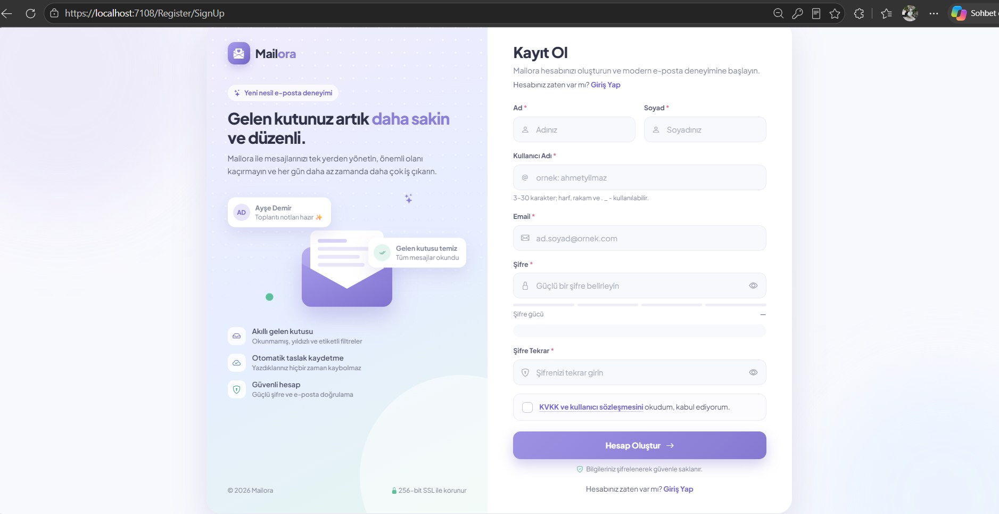<br><em>Kayıt ekranı</em></p>

Kayıt başarılı olduğunda sistem kriptografik olarak güvenli rastgele bir **6 haneli doğrulama kodu** üretir, kullanıcının kaydına yazar ve **gerçek bir e-posta** olarak kullanıcının adresine gönderir. E-posta gönderilemezse yarım bir kayıt bırakılmaz; oluşturulan kullanıcı silinir ve kullanıcıya anlaşılır bir hata gösterilir.

<p align="center">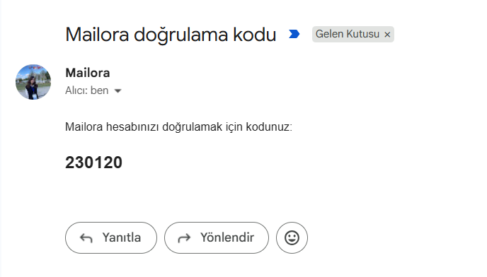<br><em>Kullanıcının e-posta kutusuna gelen doğrulama kodu</em></p>

Kullanıcı ardından **doğrulama ekranına** yönlenir ve e-postadaki kodu girer. Kod doğruysa hesap onaylanır, kullanılan kod veritabanından silinir ve kullanıcı giriş sayfasına yönlendirilir. Kod hatalıysa genel bir hata mesajı gösterilir. **Kod doğrulanmadan giriş yapılamaz** (`RequireConfirmedEmail`).

<p align="center">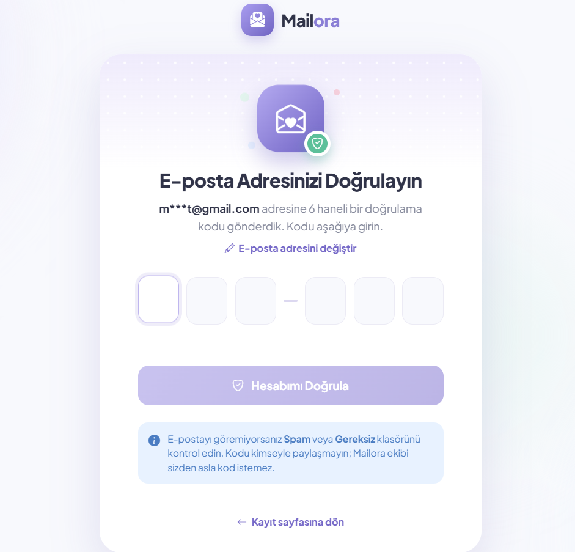<br><em>6 haneli kodun girildiği doğrulama ekranı</em></p>

### Giriş ve çıkış

Giriş **kullanıcı adı ve şifre** ile yapılır. Başarılı girişte kullanıcı Gelen Kutusuna yönlenir.

<p align="center">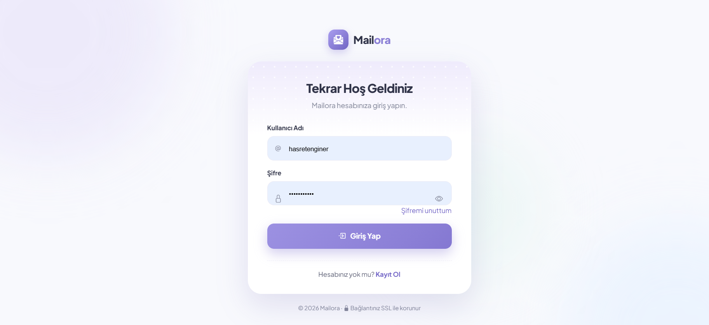<br><em>Giriş ekranı</em></p>

- E-postasını doğrulamamış bir kullanıcı **doğru şifreyle** girmeyi denerse doğrulama ekranına yönlendirilir.
- Art arda hatalı denemelerde Identity **hesap kilitleme** devreye girer.
- Yanlış kullanıcı adı ile yanlış şifre aynı mesajı verir ("Kullanıcı adı veya şifre hatalı."); böylece bir kullanıcı adının sistemde olup olmadığı anlaşılamaz.
- **Çıkış**, anti-forgery korumalı bir POST isteğiyle yapılır; navbar'daki kullanıcı menüsünden erişilir.
- Oturum çerezi 7 gün geçerlidir. Mesaj, profil ve dashboard sayfaları yalnızca giriş yapmış kullanıcılara açıktır; girişsiz erişimde kullanıcı giriş sayfasına yönlendirilir, AJAX isteklerinde ise yönlendirme yerine `401` durum kodu döner.

### Şifre işlemleri

**Şifremi unuttum.** Giriş sayfasındaki bağlantıdan açılan ekranda kullanıcı e-posta adresini yazar. Adres kayıtlı ve doğrulanmışsa kullanıcıya **30 dakika geçerli, tek kullanımlık** bir şifre sıfırlama bağlantısı e-postayla gönderilir. Adres kayıtlı olsa da olmasa da ekranda **aynı bilgilendirme mesajı** görünür; böylece biri hangi e-postaların kayıtlı olduğunu deneyerek öğrenemez.

<p align="center"><br><em>Şifremi unuttum ekranı</em></p>

**Yeni şifre belirleme.** E-postadaki bağlantı açıldığında token önce doğrulanır (harcanmadan). Geçerliyse kullanıcı yeni şifresini iki kez girer. Şifre kaydedilince token geçersiz olur (kullanıcının `SecurityStamp` değeri yenilenir); aynı bağlantı ikinci kez kullanılamaz. Bağlantı **geçersiz, süresi dolmuş ya da daha önce kullanılmışsa** hata sayfası yerine, kullanıcıyı "Yeni bağlantı iste" düğmesiyle yeniden yönlendiren anlaşılır bir "Bağlantı geçersiz" ekranı gösterilir.

**Şifre değiştirme.** Giriş yapmış kullanıcı, sidebar'daki **Ayarlar** bağlantısından şifre değiştirme sayfasına gider. Önce **mevcut şifresini** doğrular, ardından yeni şifreyi iki kez girer. Başarılı değişimden sonra kullanıcının oturumu açık kalır; diğer cihazlardaki oturumlar ise düşer.

<p align="center">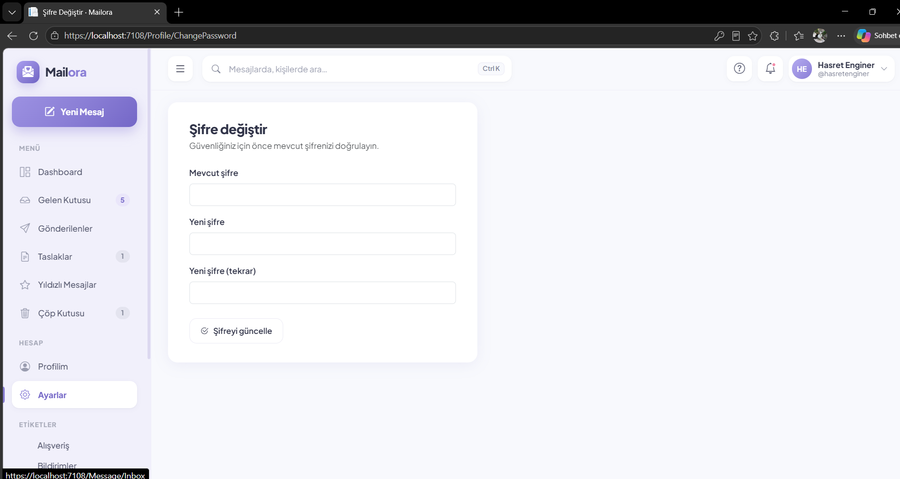<br><em>Oturum açıkken şifre değiştirme</em></p>

### Gelen Kutusu

Gelen Kutusu, **yalnızca oturum açan kullanıcıya gönderilmiş** mesajları listeler; en yeni mesaj en üstte olacak şekilde tarihe göre sıralanır. Hiçbir kullanıcı başkasının mesajlarını göremez; liste her zaman sunucuda oturumdaki kullanıcının e-postasıyla süzülür.

<p align="center">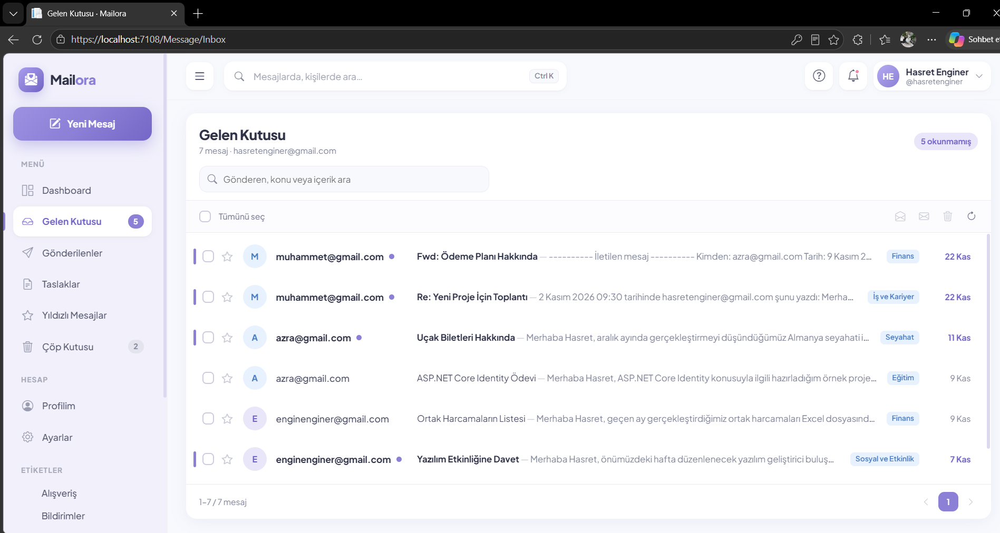<br><em>Gelen Kutusu</em></p>

Liste üzerinde şunlar yapılabilir:

- **Okunmamış** mesajlar kalın yazı ve nokta ile ayırt edilir. Okunmamış mesaj sayısı liste başlığında ve sidebar rozetinde veritabanından hesaplanarak gösterilir.
- **Yıldızlama / yıldızı kaldırma:** Her satırdaki yıldıza tıklanır; işlem anında arayüze yansır ve arka planda sunucuya kaydedilir.
- **Okundu / okunmadı işaretleme** ve **çöpe taşıma** işlemleri tek tek ya da birden çok mesaj seçilerek yapılır.
- **Arama:** Gönderen, konu ve içerik üzerinde anlık arama yapılır; navbar'daki arama kutusu ile liste araması birbirine bağlıdır.
- **Filtreler:** Tümü / Okunmamış / Yıldızlı filtreleri ve **kategori filtresi** bulunur. Liste sayfalanır.
- `j` / `k` tuşlarıyla satırlar arasında klavyeyle gezilebilir.

### Mesaj detayı

Bir mesaja tıklandığında detay sayfası açılır. Mesajı açan kişi alıcı ise mesaj otomatik olarak **okundu** işaretlenir. Sayfada konu, gönderen, alıcı, tarih, kategori ve okunma durumu gösterilir; mesaj içeriği zengin metin olarak görüntülenir. Başkasına ait bir mesajın adresi elle denendiğinde sayfa mesajın var olduğunu bile açıklamaz ve **404** döner.

<p align="center">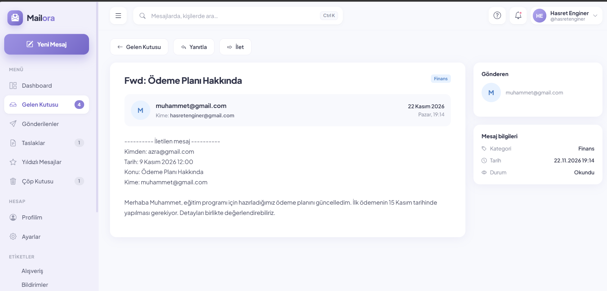<br><em>Mesaj detayı</em></p>

Detay sayfasından mesaja **Yanıtla** ya da **İlet** ile devam edilebilir (aşağıda).

### Yeni mesaj gönderme, yanıtlama ve iletme

**Yeni mesaj** formunda alıcı, kategori, konu ve içerik girilir. Gönderen bilgisi formdan değil, **oturum açan hesaptan** alınır; kimse başka biri adına mesaj gönderemez. Sunucu şunları doğrular:

- Alıcı geçerli bir e-posta adresi olmalı ve **sistemde kayıtlı bir kullanıcıya** ait olmalıdır.
- Kategori veritabanında bulunmalıdır.
- Konu zorunludur ve en fazla 200 karakterdir; içerik zorunludur.

Mesaj içeriği zengin metin (HTML) olarak saklanır ve kaydedilmeden önce **HtmlSanitizer** ile temizlenir; böylece içeriğe zararlı kod yerleştirilemez. Gönderilen mesaj, alıcının **Gelen Kutusuna** ve göndericinin **Gönderilenler** alanına yansır. Gönderim sonrasında kullanıcı Gönderilenler sayfasına yönlenir.

**Yanıtla**, orijinal mesajın göndericisini alıcı olarak seçer, kategoriyi ve konuyu (`Re:` ön ekiyle) doldurur ve orijinal mesajı alıntı olarak içeriğe ekler. **İlet** ise konuyu `Fwd:` ile başlatır, orijinal mesajı "İletilen mesaj" bilgisiyle içeriğe ekler ve alıcıyı boş bırakır. İkisi de yeni bir mesaj oluşturur; orijinal mesaja dokunmaz. Yalnızca kullanıcının erişebildiği mesajlar yanıtlanabilir ya da iletilebilir.

### Gönderilenler ve Yıldızlı mesajlar

**Gönderilenler**, kullanıcının gönderdiği mesajları listeler. **Yıldızlı Mesajlar** sayfası, kullanıcının yıldızladığı mesajları (hem aldığı hem gönderdiği) bir arada gösterir. Yıldız **kullanıcıya özeldir**: gönderen ve alıcı aynı mesajı birbirinden bağımsız olarak yıldızlayabilir.

<p align="center">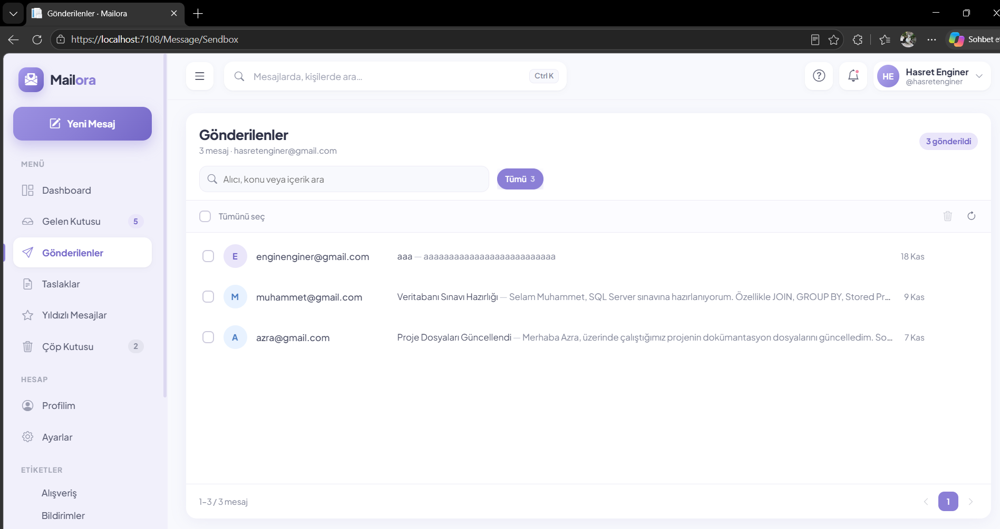<br><em>Gönderilenler</em></p>

### Taslaklar

Mesaj formunda **Taslak kaydet** düğmesi, zorunlu alanlar eksik olsa bile mesajı taslak olarak saklar. Taslaklar sayfasında kayıtlı taslaklar listelenir; bir taslağa tıklanınca form dolu hâlde yeniden açılır, düzenlenir ve **gönderilir**. Gönderilen taslak aynı kayıt üzerinden normal mesaja dönüşür. Taslaklar toplu olarak silinebilir; taslakların karşı tarafı olmadığı için silinen taslak doğrudan veritabanından kaldırılır.

<p align="center">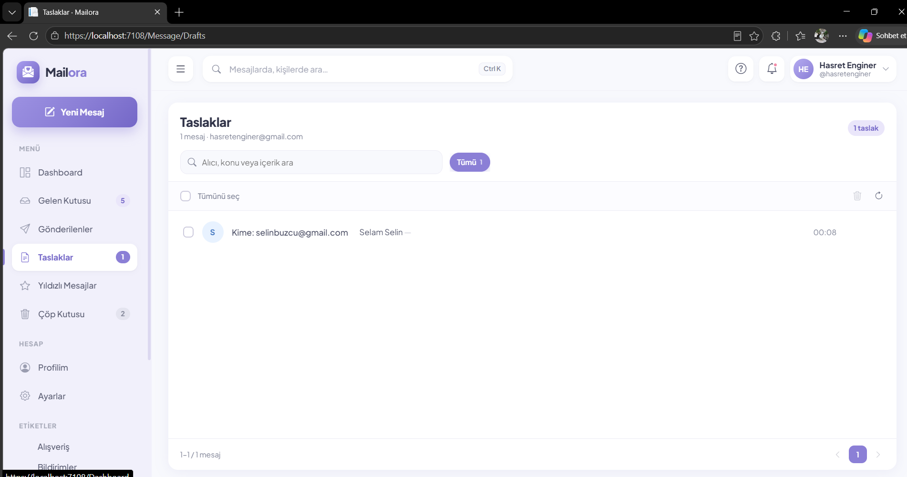<br><em>Taslaklar</em></p>

### Çöp Kutusu

Mesajlar Gelen Kutusu ya da Gönderilenler'den **çöp kutusuna** taşınır. Taşıma sonrasında bir **"Geri Al"** seçeneği sunulur. Çöp Kutusu sayfasında mesajlar **geri alınabilir** ya da **kalıcı olarak silinebilir**. Silme **kullanıcıya özeldir**: bir taraf mesajı silince diğer tarafın kutusu etkilenmez; iki taraf da mesajı kalıcı olarak sildiğinde kayıt veritabanından tamamen kaldırılır.

<p align="center">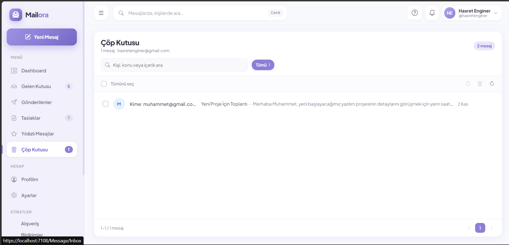<br><em>Çöp Kutusu</em></p>

### Kategoriler, sidebar ve navbar

Mesaj kategorileri **veritabanındaki `Categories` tablosundan** gelir. Yeni mesaj formunda kategori listesinden seçilir; Gelen Kutusu satırlarında mesajın kategorisi etiket olarak görünür.

**Sidebar**, oturum açan kullanıcının verileriyle dinamik olarak oluşturulur:

- Okunmamış (Gelen Kutusu), Taslaklar, Yıldızlı ve Çöp Kutusu sayaçları veritabanından hesaplanır.
- **Etiketler** bölümü veritabanındaki kategorilerden üretilir; her kategorinin yanında o kategorideki **okunmamış mesaj sayısı** görünür ve seçili kategori vurgulanır. Bir etikete tıklamak Gelen Kutusunu o kategoriye göre süzer.

**Navbar**, oturum açan kullanıcının adını, soyadını ve kullanıcı adını gösterir; çıkış buradan yapılır.

### Profil

**Profilim** sayfasında kullanıcı **ad, soyad ve "Hakkımda" açıklamasını** günceller. Kullanıcı adı ve e-posta adresi değiştirilemez, salt okunur gösterilir.

Aynı sayfadan **profil fotoğrafı** yüklenir ya da kaldırılır. Yüklenen dosyanın gerçekten bir resim olduğu dosyanın **içeriğine bakılarak** doğrulanır (JPG, PNG, WebP; en fazla 2 MB); dosya adı rastgele üretilir ve eski fotoğraf otomatik silinir.

<p align="center">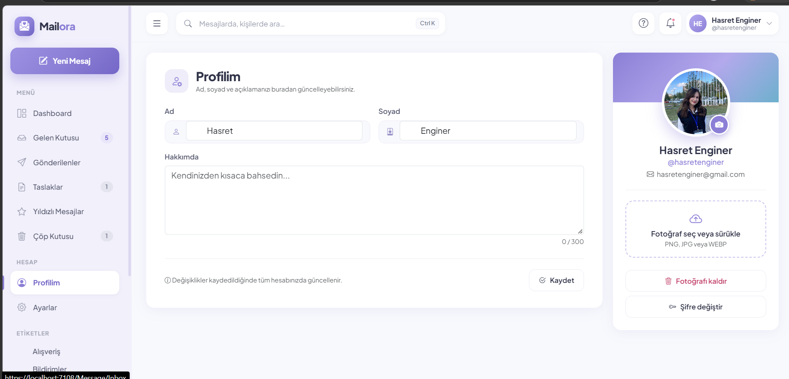<br><em>Profilim ve profil fotoğrafı</em></p>

### Dashboard

Dashboard, kullanıcının posta kutusunun **gerçek verilerden hesaplanmış** bir özetidir:

- **Karşılama:** Günün saatine göre selamlama, tarih ve hızlı eylemler (Yeni mesaj, Gelen kutusu).
- **Özet kartları:** Gelen kutusu adedi ve geçen haftaya göre değişimi; okunmamış mesaj adedi ve okunma oranı; gönderilen mesaj adedi ve geçen haftaya göre değişimi; bugün gelen mesaj sayısı ile taslak ve yıldızlı adetleri. Kartlar ilgili listelere bağlanır.
- **Mesaj trafiği grafiği:** Son 14 günün günlük gelen ve gönderilen mesaj sayıları.
- **Kategori dağılımı:** Gelen kutusundaki mesajların kategorilere göre halka grafiği.

<p align="center">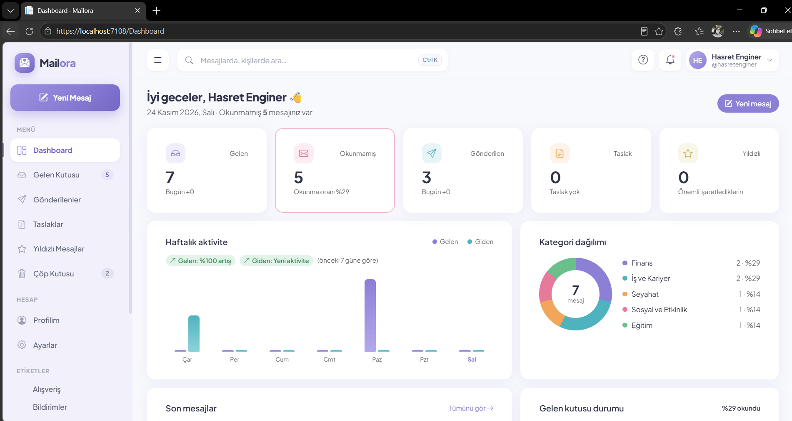<br><em>Dashboard: özet kartları ve grafikler</em></p>

- **Son mesajlar:** Gelen kutusundaki en yeni mesajlar; tıklayınca mesaj açılır.
- **En çok yazanlar:** Gelen kutusuna en çok mesaj gönderen 5 kişi; bir kişiye tıklamak Gelen Kutusunu o kişiye göre arar.

<p align="center">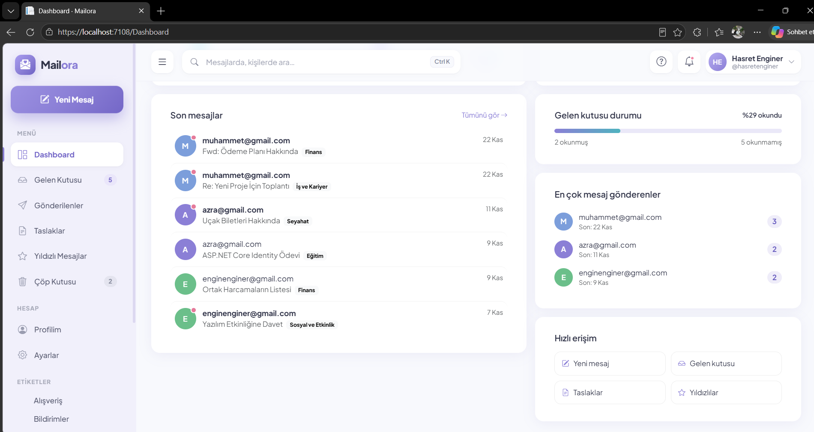<br><em>Dashboard: son mesajlar ve en çok yazanlar</em></p>

Sayılar sunucuda `COUNT` / `GROUP BY` sorgularıyla hesaplanır; listeler yalnızca gereken sütunları çeker. Haftalık karşılaştırma tek bir 14 günlük sorgudan türetilir.

### Hata sayfaları

Uygulama, tema ile uyumlu **özel hata sayfaları** kullanır:

- **401:** Giriş yapılması gereken bir sayfaya girişsiz erişildiğinde.
- **403:** Kullanıcının yetkisi olmayan bir sayfaya erişildiğinde.
- **404:** Bulunamayan adreslerde; ayrıca başkasına ait bir mesajın adresi denendiğinde.

HTTP durum kodu korunur. Sayfalardaki düğme, kullanıcı giriş yapmışsa Gelen Kutusuna, yapmamışsa giriş sayfasına yönlendirir.

<p align="center"><br><em>401: Giriş gerekli sayfası</em></p>

---

## Teknolojiler

| Alan | Kullanılan |
|---|---|
| Çatı | ASP.NET Core MVC (.NET 9) |
| Kimlik | ASP.NET Core Identity (`UserManager`, `SignInManager`, token sağlayıcıları) |
| Veri erişimi | Entity Framework Core 9 (Code First, Migrations) |
| Veritabanı | Microsoft SQL Server |
| E-posta | MailKit / MimeKit (SMTP) |
| HTML temizleme | HtmlSanitizer (`Ganss.Xss`) |
| Arayüz | Bootstrap 5.3, Bootstrap Icons, Plus Jakarta Sans, Mailora teması |
| Grafikler | Chart.js (Dashboard) |
| Gizli bilgiler | .NET User Secrets |

---

## Kurulum ve Çalıştırma

### Gereksinimler

- [.NET 9 SDK](https://dotnet.microsoft.com/download)
- SQL Server (LocalDB, Express veya tam sürüm)
- Visual Studio 2022 **ya da** komut satırı (`dotnet` CLI)
- Doğrulama ve şifre sıfırlama e-postaları için bir SMTP hesabı (örn. Gmail + [uygulama şifresi](https://support.google.com/accounts/answer/185833))

### Adımlar

**1) Projeyi indirin**

```bash
git clone <repo-adresi>
cd MYAcademy_IdentityEmailProject/MYAcademy_IdentityEmailProject
```

**2) Veritabanı bağlantısını ayarlayın**

`Context/EmailContext.cs` içindeki bağlantı dizesinde `Server=` kısmını kendi SQL Server örneğinizle değiştirin:

```csharp
optionsBuilder.UseSqlServer(
    "Server=<SUNUCU_ADINIZ>;initial Catalog=IdentityEmailDb;integrated Security=true;trust server certificate=true",
    o => o.UseCompatibilityLevel(110));
```

> `UseCompatibilityLevel(110)` eski SQL Server sürümleri (2012) için gereklidir. Daha yeni bir SQL Server kullanıyorsanız kaldırabilir veya yükseltebilirsiniz.

**3) Migration'ları uygulayarak veritabanını oluşturun**

Visual Studio → Package Manager Console:

```powershell
Update-Database
```

veya komut satırı:

```bash
dotnet tool install --global dotnet-ef      # bir kez
dotnet ef database update
```

**4) Kategorileri ekleyin**

Kategoriler veritabanından okunur; tablo boşsa sidebar etiketleri ve mesaj formundaki kategori listesi boş görünür. Örnek veri:

```sql
INSERT INTO Categories (CategoryName)
VALUES (N'İş ve Kariyer'), (N'Eğitim'), (N'Finans'), (N'Teknoloji'), (N'Alışveriş'), (N'Bildirimler');
```

**5) SMTP ayarlarını yapın**

Gizli olmayan ayarlar `appsettings.json` içindedir:

```json
"Smtp": {
  "Host": "smtp.gmail.com",
  "Port": 587,
  "FromName": "Mailora",
  "FromAddress": "gonderen@gmail.com"
}
```

Kullanıcı adı ve şifre **koda veya `appsettings.json`'a yazılmaz**, User Secrets ile saklanır (proje klasöründe):

```bash
dotnet user-secrets init
dotnet user-secrets set "Smtp:UserName" "gonderen@gmail.com"
dotnet user-secrets set "Smtp:Password" "uygulama-sifresi"
```

Visual Studio'da: projeye sağ tık → **Manage User Secrets**. Canlı ortamda aynı değerler ortam değişkeni olarak verilir (`Smtp__Password`).

**6) Çalıştırın**

```bash
dotnet run
```

Adres, `Properties/launchSettings.json` içindeki porta göredir (örn. `https://localhost:7108`).

---

## Veritabanı ve Migration Bilgisi

- **Yaklaşım:** Code First. Veritabanı, `Migrations` klasöründeki migration'lardan oluşur; elle şema oluşturmaya gerek yoktur.
- **Veritabanı adı:** `IdentityEmailDb`
- **Yeni migration eklemek için:** `Add-Migration <Ad>` / `dotnet ef migrations add <Ad>`, ardından `Update-Database`.

### Tablolar

| Tablo | Açıklama |
|---|---|
| `AspNetUsers` (+ diğer Identity tabloları) | Kullanıcılar. `AppUser` ile **Name, Surname, Description, ImageUrl, ValidCode** alanları eklendi |
| `Messages` | Tüm mesajlar ve taslaklar |
| `Categories` | Mesaj kategorileri |

### `Messages` tablosu

| Sütun | Açıklama |
|---|---|
| `MessageId` | Birincil anahtar |
| `Subject`, `MessageDetail` | Konu ve içerik (içerik HTML'dir, kaydedilirken temizlenir) |
| `SenderEmail`, `ReceiverEmail` | Gönderen / alıcı e-postası (Identity hesabıyla eşleşir) |
| `SendDate` | Gönderim tarihi |
| `IsRead` | Alıcı okudu mu |
| `CategoryId` | `Categories` tablosuna yabancı anahtar (boş olabilir) |
| `IsDraft` | Taslak mı |
| `IsStarredBySender`, `IsStarredByReceiver` | Taraf bazlı yıldız |
| `IsTrashedBySender`, `IsTrashedByReceiver` | Taraf bazlı çöp kutusu |
| `IsDeletedBySender`, `IsDeletedByReceiver` | Taraf bazlı kalıcı silme |

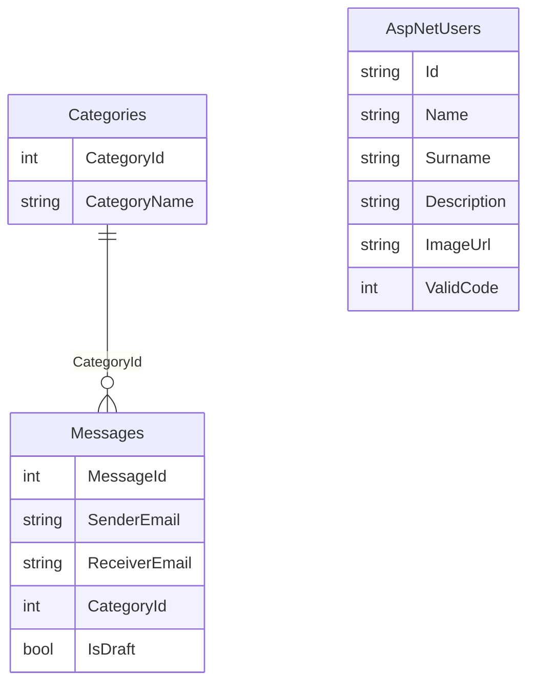

> `Messages` ile kullanıcılar arasındaki bağ yabancı anahtar değil, **e-posta adresi eşleşmesidir** (`SenderEmail` / `ReceiverEmail`).

---

## Güvenlik Önlemleri

| Tehdit | Önlem |
|---|---|
| Başkasının mesajına erişim (IDOR) | Her sorgu sunucuda oturumdaki kullanıcının e-postasıyla süzülür (`InboxOf`, `SentOf`, `AccessibleBy`...). Erişim yoksa `Forbid` yerine `NotFound` döner |
| Kimlik taklidi | Gönderen, taşıyıcı ID veya formdan değil `UserManager` ile oturumdan alınır |
| Overposting | Formlar entity yerine ViewModel kullanır; salt okunur alanlarda `[BindNever]` |
| CSRF | Tüm POST işlemlerinde `[ValidateAntiForgeryToken]`; AJAX isteklerinde token otomatik eklenir |
| XSS | Mesaj HTML'i `HtmlSanitizer` ile temizlenir; kullanıcı girdileri Razor ile kodlanarak yazılır |
| Kaba kuvvet | Identity hesap kilitleme; genel hata mesajı |
| Kullanıcı listeleme | Giriş ve şifre sıfırlamada kullanıcı var/yok bilgisi sızdırılmaz |
| Şifre sıfırlama | Identity token'ı, 30 dk ömür, tek kullanımlık (SecurityStamp) |
| Güvenli kod üretimi | Doğrulama kodu `RandomNumberGenerator` ile üretilir |
| Dosya yükleme | İçerik imzası kontrolü, 2 MB sınır, rastgele dosya adı, SVG kabul edilmez, yol manipülasyonuna karşı `Path.GetFileName` |
| Gizli bilgi sızıntısı | SMTP bilgileri User Secrets'ta; hata sayfaları ayrıntı göstermez |
| Oturum | Çıkış POST ile; AJAX isteklerinde oturum bitince `401` |
| SQL Injection | EF Core parametreli sorgular |

---

## Mimari ve Tasarım Kararları

**Taraf bazlı mesaj durumu.** Bir mesaj tek kayıttır ama gönderen ve alıcı onu ayrı ayrı yönetir. Yıldız, çöp ve silme için ayrı `...BySender` / `...ByReceiver` bayrakları tutulur. Böylece bir tarafın silmesi diğerinin kutusunu bozmaz. İki taraf da sildiğinde satır fiziksel olarak kaldırılır. Taslaklar karşı tarafı olmadığı için doğrudan silinir.

**Tek doğruluk kaynağı: sorgu yardımcıları.** `Extensions/MessageQueryExtensions.cs` içindeki `InboxOf`, `SentOf`, `DraftsOf`, `StarredOf`, `TrashOf` ve `AccessibleBy` metotları hangi mesajın hangi listede ve kimin için görüneceğini tek yerde tanımlar. Listeler, sidebar sayaçları, dashboard ve işlem uç noktaları aynı kuralları kullanır; bu yüzden sayılarla listeler tutarsız olmaz ve sahiplik kuralı unutulamaz.

**ViewModel katmanı.** Tüm formlar ve ekranlar ayrı ViewModel kullanır (`CreateMessageViewModel`, `MessageDetailViewModel`, `SidebarCountsViewModel`, `DashboardViewModel`, `ProfileViewModel`...).

**ViewComponent'ler.** Header ve sidebar, oturum açan kullanıcının verisini ve sayaçları veritabanından üretir.

**Post-Redirect-Get.** Başarılı form işlemlerinden sonra yönlendirme yapılır; sayfa yenilenince işlem tekrarlanmaz. Bilgi mesajları `TempData` ile taşınır.

**AJAX işlemleri.** Yıldız, okundu/okunmadı, çöpe taşıma gibi işlemler arayüzde anında uygulanır (iyimser güncelleme), arka planda `fetch` ile sunucuya gönderilir; hata olursa arayüz geri alınır. Toplu işlemler `int[] ids` ile yapılır.

**E-posta servisi.** `IMailService` arayüzü ve `SmtpMailService` uygulaması e-posta göndermeyi tek yerde toplar; ayarlar `IOptions<SmtpSettings>` ile gelir.

---

## Proje Yapısı

```
MYAcademy_IdentityEmailProject
├── Context/            EmailContext (EF Core DbContext)
├── Controllers/        Register, Login, Message, Profile, Dashboard, ErrorPages
├── Entities/           AppUser, Message, Category
├── Extensions/         MessageQueryExtensions (liste ve sahiplik kuralları)
├── Migrations/         EF Core migration'ları
├── Models/             ViewModel sınıfları
├── Services/           IMailService, SmtpMailService, SmtpSettings
├── ViewComponents/     MessageLayout header ve sidebar bileşenleri
├── Views/
│   ├── Register/       SignUp, ConfirmEmail
│   ├── Login/          SignIn, ForgotPassword, ResetPassword, ResetPasswordInvalid
│   ├── Message/        Inbox, Sendbox, Starred, Drafts, Trash, Detail, CreateMessage
│   ├── Profile/        Index, ChangePassword
│   ├── Dashboard/      Index
│   ├── ErrorPages/     Page401, Page403, Page404
│   └── MessageLayout/  Ortak uygulama düzeni
├── wwwroot/
│   └── uploads/avatars/  Yüklenen profil fotoğrafları (Git'e dahil değildir)
└── Program.cs
```

---

## Rota / Endpoint Özeti

| Controller | Action | Yöntem | Açıklama |
|---|---|---|---|
| Register | `SignUp` | GET/POST | Kayıt |
| Register | `ConfirmEmail` | GET/POST | 6 haneli kod doğrulama |
| Login | `SignIn` | GET/POST | Giriş |
| Login | `LogOut` | POST | Çıkış |
| Login | `ForgotPassword` | GET/POST | Sıfırlama bağlantısı iste |
| Login | `ResetPassword` | GET/POST | Yeni şifre belirle (token ile) |
| Message | `Inbox`, `Sendbox`, `Starred`, `Drafts`, `Trash` | GET | Listeler (`?label=` kategori, `?q=` arama) |
| Message | `Detail/{id}` | GET | Mesaj detayı |
| Message | `CreateMessage` | GET/POST | Yeni mesaj / taslağı düzenle (`?draftId=`) |
| Message | `SaveDraft` | POST | Taslak kaydet |
| Message | `Reply/{id}`, `Forward/{id}` | GET | Yanıtla / İlet formunu hazırla |
| Message | `ToggleStar` | POST | Yıldızla / kaldır |
| Message | `MarkAsRead`, `MarkAsUnread` | POST | Okundu / okunmadı (çoklu) |
| Message | `MoveToTrash`, `Restore`, `DeletePermanently`, `DeleteDrafts` | POST | Çöp kutusu ve silme (çoklu) |
| Profile | `Index` | GET/POST | Profil bilgileri |
| Profile | `UploadPhoto`, `RemovePhoto` | POST | Profil fotoğrafı |
| Profile | `ChangePassword` | GET/POST | Şifre değiştir |
| Dashboard | `Index` | GET | Özet istatistikler |
| ErrorPages | `Page401`, `Page403`, `Page404` | GET | Hata ekranları |

`Register`, `Login` ve `ErrorPages` dışındaki tüm controller'lar `[Authorize]` ile korunur.

---

## Bilinen Sınırlamalar

Aşağıdakiler bilinçli tercihler ya da henüz geliştirilmemiş kısımlardır:

1. **Yeni mesaj gönderimi veritabanı üzerindendir.** Uygulama içinden gönderilen mesajlar, sistemde kayıtlı kullanıcıya veritabanı üzerinden iletilir; her mesaj için ayrıca gerçek bir e-posta gönderilmez. SMTP altyapısı kuruludur ve **doğrulama kodu** ile **şifre sıfırlama bağlantısı** gerçek e-posta olarak gönderilir. İstenirse `IMailService` üzerinden mesaj gönderimine de bağlanabilir.
2. **Alıcı, sistemde kayıtlı bir kullanıcı olmak zorundadır.** Sistem dışı bir adrese mesaj gönderilemez (1. maddeyle ilişkilidir).
3. **Doğrulama kodunun süresi ve deneme sınırı yoktur.** 6 haneli koda yönelik kaba kuvvet denemesini sınırlamak için ileride deneme sayacı eklenebilir.
4. **Geliştirmeye açık özellikler:** dosya eki yükleme/indirme, çoklu alıcı, CC/BCC alanları, mesaj arşivleme ve yeni mesaj bildirimleri henüz yoktur.
5. **Sayaçlar sayfa yüklenirken hesaplanır.** Gelen Kutusu rozeti sayfa içinde anlık güncellenir; diğer rozetler bir sonraki sayfa yüklemesinde yenilenir.
6. **Identity'nin bazı doğrulama hata metinleri İngilizcedir** (örn. şifre kuralı mesajları). Sık görülenler (yanlış mevcut şifre) Türkçeleştirilmiştir.
7. **Bağlantı dizesi `EmailContext.cs` içindedir.** Kurulumda sunucu adının orada güncellenmesi gerekir (bkz. Kurulum, 2. adım).
8. **Navbar'daki bildirim menüsü tema örneğidir;** gerçek bir bildirim sistemi yoktur.

---

## Hızlı Test Senaryosu

1. **İki hesap açın** (A ve B). Her biri için kayıt olun, e-postadan gelen kodu girin.
2. Doğrulama yapmadan giriş yapmayı deneyin → doğrulama ekranına yönlenmelisiniz.
3. A ile giriş yapın, B'ye bir mesaj gönderin (kategori seçerek). Mesaj A'nın **Gönderilenler**'inde görünmeli.
4. B ile giriş yapın. Mesaj **Gelen Kutusu**nda okunmamış görünmeli; sidebar rozeti `1` olmalı. Mesajı açın → okundu olmalı.
5. Mesajı yıldızlayın → **Yıldızlı** sayfasında görünmeli; rozet güncellenmeli.
6. **Yanıtla** ile A'ya cevap verin; **İlet** ile başka bir kullanıcıya iletin.
7. Bir mesajı çöpe taşıyın → **Çöp Kutusu**nda görünmeli → **geri alın** → tekrar silin → **kalıcı silin**.
8. Taslak kaydedin → **Taslaklar**dan açıp düzenleyin ve gönderin.
9. Sidebar'dan bir **kategori** seçin; liste süzülmeli. Aramayı deneyin.
10. **Güvenlik:** B'nin bir mesaj numarasını (`/Message/Detail/5`) A ile giriş yaparken açmayı deneyin → **404** gelmeli.
11. **Şifremi Unuttum** ile bağlantı isteyin, şifreyi yenileyin, **aynı bağlantıyı tekrar** açın → "Bağlantı geçersiz" görmelisiniz.
12. **Profilim**'den adınızı değiştirin, fotoğraf yükleyin (`.txt` dosyasını `.jpg` yapıp yüklemeyi de deneyin → reddedilmeli).
13. **Dashboard**'daki sayıların listelerle tutarlı olduğunu kontrol edin.
14. Olmayan bir adrese gidin → özel **404** sayfası görünmeli.

---

## Lisans / Not

Bu proje eğitim amaçlı bir bootcamp projesi olarak hazırlanmıştır.
