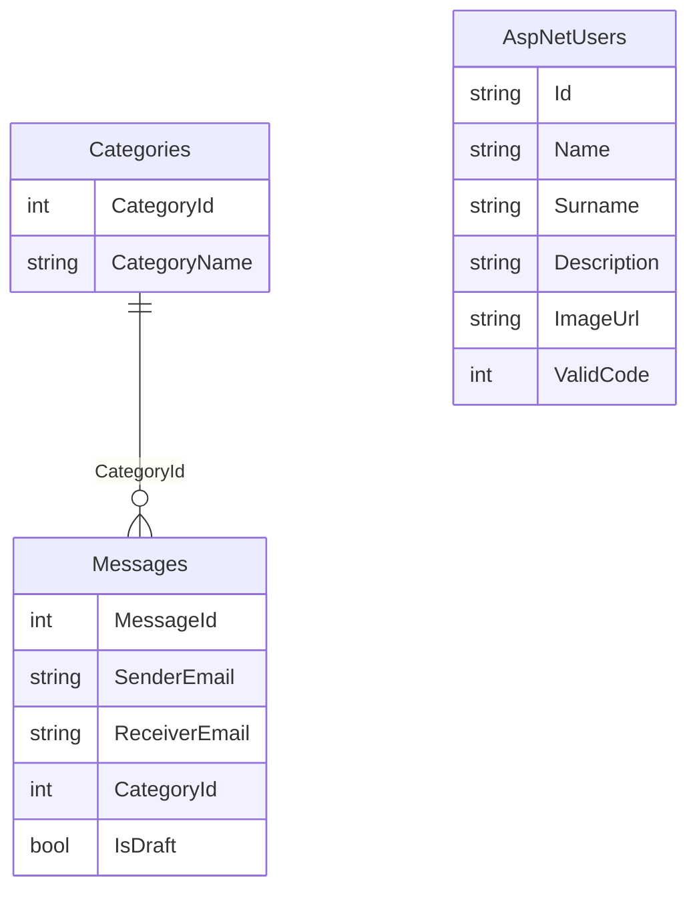

# Mailora | Identity E-Posta Yönetim Sistemi

ASP.NET Core MVC, ASP.NET Core Identity ve Entity Framework Core ile geliştirilmiş, **kullanıcıya özel çalışan, veritabanı destekli** bir e-posta yönetim sistemi. Tasarım, verilen statik **Mailora** temasının dinamik hâle getirilmesiyle oluşturulmuştur. Tüm veriler (kullanıcılar, mesajlar, kategoriler) SQL Server'da tutulur; ekranlarda örnek JavaScript dizisi kullanılmaz.

> M&Y Yazılım Eğitim Akademi Danışmanlık · 12. Dönem Bootcamp · Proje Case Çalışması

 [Hasret Nisa Enginer]

---

## İçindekiler

1. [Teknolojiler](#1-teknolojiler)
2. [Case Karşılama Tablosu](#2-case-karşılama-tablosu)
3. [Kurulum ve Çalıştırma](#3-kurulum-ve-çalıştırma)
4. [Veritabanı ve Migration Bilgisi](#4-veritabanı-ve-migration-bilgisi)
5. [Özellikler (ekran görüntüleriyle)](#5-özellikler)
6. [Güvenlik Önlemleri](#6-güvenlik-önlemleri)
7. [Mimari ve Tasarım Kararları](#7-mimari-ve-tasarım-kararları)
8. [Proje Yapısı](#8-proje-yapısı)
9. [Rota / Endpoint Özeti](#9-rota--endpoint-özeti)
10. [Bilinen Sınırlamalar ve Sapmalar](#10-bilinen-sınırlamalar-ve-sapmalar)
11. [Hızlı Test Senaryosu](#11-hızlı-test-senaryosu)

---

## 1. Teknolojiler

| Alan | Kullanılan |
|---|---|
| Çatı | ASP.NET Core MVC (.NET 9) |
| Kimlik | ASP.NET Core Identity (`UserManager`, `SignInManager`, token sağlayıcıları) |
| Veri erişimi | Entity Framework Core 9 (Code First, Migrations) |
| Veritabanı | Microsoft SQL Server |
| E-posta | MailKit / MimeKit (SMTP) |
| HTML temizleme | HtmlSanitizer (`Ganss.Xss`) |
| Arayüz | Bootstrap 5.3, Bootstrap Icons, Plus Jakarta Sans, Mailora teması |
| Gizli bilgiler | .NET User Secrets |

---

## 2. Case Karşılama Tablosu

| # | Case maddesi | Durum | Nerede / Nasıl |
|---|---|---|---|
| 01 | Identity ile Register / Login / Logout | ✅ | `RegisterController`, `LoginController` |
| 01 | Kayıtta 6 haneli doğrulama kodu, doğrulamadan giriş yok | ✅ | Kod e-postayla gider; `RequireConfirmedEmail = true` |
| 01 | Giriş gerektiren sayfalar korunur; 401 / 403 / 404 ekranları | ✅ | `[Authorize]`, `ErrorPagesController`, status code yönlendirmesi |
| 02 | "Şifremi Unuttum" ile e-postayla tek kullanımlık yenileme bağlantısı | ✅ | Identity token'ı (30 dk, tek kullanımlık) |
| 02 | Mevcut şifreyi değiştirme; geçersiz/süresi dolmuş bağlantılar güvenli ele alınır | ✅ | `ProfileController.ChangePassword`, `ResetPasswordInvalid` ekranı |
| 02 | Başkasının mesajına URL/parametre ile erişilemez | ✅ | Her sorguda sahiplik filtresi, `NotFound()` |
| 03 | Gelen mesajlar yalnızca oturum açan alıcıya göre listelenir | ✅ | `InboxOf(email)` |
| 03 | Detay, okundu/okunmadı, yıldızla / yıldızı kaldır | ✅ | `Detail`, `MarkAsRead/Unread`, `ToggleStar` |
| 03 | Arama, kategori filtresi, tarihe göre sıralama, okunmamış sayısı dinamik | ✅ | Liste en yeni mesaj üstte; sayaçlar veritabanından |
| 04 | Gönderen Identity hesabından; alıcı/konu/içerik doğrulanır | ✅ | `CreateMessageViewModel` + sunucu doğrulaması |
| 04 | Kayıtlı kullanıcıya mesaj → alıcının Gelen Kutusu, göndericinin Gönderilenler | ✅ | Tek `Messages` kaydı, iki tarafın görünümü |
| 04 | SMTP ile gerçek e-posta adresine mesaj gönderimi | ⚠️ | Mesaj gönderimi **yalnızca veritabanı üzerinden**. SMTP, doğrulama kodu ve şifre sıfırlamada kullanılır. Bkz. [Sapmalar](#10-bilinen-sınırlamalar-ve-sapmalar) |
| 05 | Gönderilenler ve Yıldızlılar kullanıcıya özel | ✅ | `SentOf`, `StarredOf` |
| 05 | Taslak kaydet / yeniden düzenle / gönder | ✅ | `SaveDraft`, `CreateMessage?draftId=` |
| 05 | Çöp kutusuna taşı / geri al / kalıcı sil | ✅ | `MoveToTrash`, `Restore`, `DeletePermanently` |
| 05 | Yanıtla ve İlet | ✅ | `Reply`, `Forward` |
| 06 | Kategoriler veritabanından; mesajda seçilir; kategoriye göre filtre | ✅ | `Categories` tablosu, sidebar etiketleri |
| 06 | Ad, soyad, profil fotoğrafı güncelleme | ✅ | `ProfileController` |
| 06 | Navbar ve profilde oturum açan kullanıcının bilgileri | ✅ | Header ViewComponent, Profilim |
| 07 | Gelen/gönderilen/okunmamış/yıldızlı/taslak adetleri gerçek veriden | ✅ | `DashboardController` |
| 07 | Son mesajlar ve kategori dağılımı | ✅ | Dashboard |
| 08 | İsteğe bağlı: dosya eki, çoklu alıcı, CC/BCC, arşiv, bildirim | ❌ | Kapsam dışı bırakıldı |

---

## 3. Kurulum ve Çalıştırma

### Gereksinimler

- [.NET 9 SDK](https://dotnet.microsoft.com/download)
- SQL Server (LocalDB, Express veya tam sürüm)
- Visual Studio 2022 **ya da** komut satırı (`dotnet` CLI)
- Doğrulama ve şifre sıfırlama e-postaları için bir SMTP hesabı (örn. Gmail + [uygulama şifresi](https://support.google.com/accounts/answer/185833))

### Adımlar

**1) Projeyi indirin**

```bash
git clone <repo-adresi>
cd MYAcademy_IdentityEmailProject/MYAcademy_IdentityEmailProject
```

**2) Veritabanı bağlantısını ayarlayın**

`Context/EmailContext.cs` içindeki bağlantı dizesinde `Server=` kısmını kendi SQL Server örneğinizle değiştirin:

```csharp
optionsBuilder.UseSqlServer(
    "Server=<SUNUCU_ADINIZ>;initial Catalog=IdentityEmailDb;integrated Security=true;trust server certificate=true",
    o => o.UseCompatibilityLevel(110));
```

> `UseCompatibilityLevel(110)` eski SQL Server sürümleri (2012) için gereklidir. Daha yeni bir SQL Server kullanıyorsanız kaldırabilir veya yükseltebilirsiniz.

**3) Migration'ları uygulayarak veritabanını oluşturun**

Visual Studio → Package Manager Console:

```powershell
Update-Database
```

veya komut satırı:

```bash
dotnet tool install --global dotnet-ef      # bir kez
dotnet ef database update
```

**4) Kategorileri ekleyin**

Kategoriler veritabanından okunur; tablo boşsa sidebar etiketleri ve mesaj formundaki kategori listesi boş görünür. Örnek veri:

```sql
INSERT INTO Categories (CategoryName)
VALUES (N'İş ve Kariyer'), (N'Eğitim'), (N'Finans'), (N'Teknoloji'), (N'Alışveriş'), (N'Bildirimler');
```

**5) SMTP ayarlarını yapın**

Gizli olmayan ayarlar `appsettings.json` içindedir:

```json
"Smtp": {
  "Host": "smtp.gmail.com",
  "Port": 587,
  "FromName": "Mailora",
  "FromAddress": "gonderen@gmail.com"
}
```

Kullanıcı adı ve şifre **koda veya `appsettings.json`'a yazılmaz**, User Secrets ile saklanır (proje klasöründe):

```bash
dotnet user-secrets init
dotnet user-secrets set "Smtp:UserName" "gonderen@gmail.com"
dotnet user-secrets set "Smtp:Password" "uygulama-sifresi"
```

Visual Studio'da: projeye sağ tık → **Manage User Secrets**. Canlı ortamda aynı değerler ortam değişkeni olarak verilir (`Smtp__Password`).

**6) Çalıştırın**

```bash
dotnet run
```

Adres, `Properties/launchSettings.json` içindeki porta göredir (örn. `https://localhost:7108`).

---

## 4. Veritabanı ve Migration Bilgisi

- **Yaklaşım:** Code First. Veritabanı, `Migrations` klasöründeki migration'lardan oluşur; elle şema oluşturmaya gerek yoktur.
- **Veritabanı adı:** `IdentityEmailDb`
- **Yeni migration eklemek için:** `Add-Migration <Ad>` / `dotnet ef migrations add <Ad>`, ardından `Update-Database`.

### Tablolar

| Tablo | Açıklama |
|---|---|
| `AspNetUsers` (+ diğer Identity tabloları) | Kullanıcılar. `AppUser` ile **Name, Surname, Description, ImageUrl, ValidCode** alanları eklendi |
| `Messages` | Tüm mesajlar ve taslaklar |
| `Categories` | Mesaj kategorileri |

### `Messages` tablosu

| Sütun | Açıklama |
|---|---|
| `MessageId` | Birincil anahtar |
| `Subject`, `MessageDetail` | Konu ve içerik (içerik HTML'dir, kaydedilirken temizlenir) |
| `SenderEmail`, `ReceiverEmail` | Gönderen / alıcı e-postası (Identity hesabıyla eşleşir) |
| `SendDate` | Gönderim tarihi |
| `IsRead` | Alıcı okudu mu |
| `CategoryId` | `Categories` tablosuna yabancı anahtar (boş olabilir) |
| `IsDraft` | Taslak mı |
| `IsStarredBySender`, `IsStarredByReceiver` | Taraf bazlı yıldız |
| `IsTrashedBySender`, `IsTrashedByReceiver` | Taraf bazlı çöp kutusu |
| `IsDeletedBySender`, `IsDeletedByReceiver` | Taraf bazlı kalıcı silme |



> `Messages` ile kullanıcılar arasındaki bağ yabancı anahtar değil, **e-posta adresi eşleşmesidir** (`SenderEmail` / `ReceiverEmail`).

---

## 5. Özellikler

> Görseller `docs/screenshots/` klasöründen yüklenir.

### 5.1 Üyelik ve hesap doğrulama (Case 01)

- **Kayıt:** Ad, soyad, kullanıcı adı, e-posta ve şifre ile kayıt. Şifre Identity'nin parola kurallarına göre doğrulanır; hatalar formda gösterilir.
- **Doğrulama kodu:** Kayıt anında kriptografik olarak güvenli rastgele **6 haneli kod** üretilir, e-postayla gönderilir ve kullanıcıya kaydedilir. E-posta gönderilemezse yarım kayıt bırakılmaz (kullanıcı silinir).
- **Doğrulama ekranı:** Kod girilene kadar giriş yapılamaz. Doğru kodda hesap onaylanır, kod silinir, kullanıcı giriş sayfasına yönlenir. Hatalı kodda genel bir hata mesajı gösterilir.
- **Giriş:** Kullanıcı adı + şifre. Doğrulanmamış hesap doğru şifreyle denerse doğrulama ekranına yönlendirilir. Hatalı denemelerde Identity **hesap kilitleme** devrededir. Hata mesajı kullanıcının varlığını sızdırmaz ("Kullanıcı adı veya şifre hatalı.").
- **Çıkış:** Anti-forgery korumalı **POST** ile yapılır.
- **Korumalı sayfalar:** Mesaj, profil ve dashboard sayfaları `[Authorize]` ile korunur. Girişsiz erişimde giriş sayfasına yönlendirme yapılır; AJAX isteklerinde yönlendirme yerine `401` döner.

<p align="center"><br><em>Kayıt ekranı</em></p>
<p align="center"><br><em>6 haneli doğrulama kodu ekranı</em></p>
<p align="center"><br><em>Gelen doğrulama e-postası</em></p>
<p align="center"><br><em>Giriş ekranı</em></p>
<p align="center"><br><em>Hatalı giriş (genel hata mesajı)</em></p>

### 5.2 Şifre işlemleri (Case 02)

- **Şifremi Unuttum:** E-posta adresi girilir. Kayıtlı ve doğrulanmış hesaba, **30 dakika geçerli, tek kullanımlık** sıfırlama bağlantısı e-postayla gönderilir. Adres kayıtlı olsa da olmasa da ekranda **aynı mesaj** gösterilir (kullanıcı listeleme saldırısına karşı).
- **Yeni şifre belirleme:** Bağlantı açıldığında token önce doğrulanır (harcanmadan). Geçerliyse form açılır; şifre kaydedilince token ölür (`SecurityStamp` yenilenir), aynı bağlantı bir daha çalışmaz.
- **Geçersiz / süresi dolmuş / kullanılmış bağlantı:** Hata fırlatmak yerine "Bağlantı geçersiz" ekranı ve "Yeni bağlantı iste" düğmesi gösterilir.
- **Şifre değiştirme:** Giriş yapmış kullanıcı **mevcut şifresini** doğrulayarak yeni şifre belirler. Başarılı değişimden sonra oturum açık kalır, diğer cihazlardaki oturumlar düşer.

<p align="center"><br><em>Şifremi unuttum</em></p>
<p align="center"><br><em>Şifre sıfırlama e-postası</em></p>
<p align="center"><br><em>Yeni şifre belirleme</em></p>
<p align="center"><br><em>Geçersiz / kullanılmış bağlantı</em></p>
<p align="center"><br><em>Oturum açıkken şifre değiştirme</em></p>

### 5.3 Gelen Kutusu ve mesaj detayı (Case 03)

- Gelen kutusu **yalnızca oturum açan alıcının** mesajlarını listeler; en yeni mesaj üstte olacak şekilde tarihe göre sıralanır.
- Okunmamış mesajlar kalın ve noktalı gösterilir; **okunmamış sayısı** hem liste başlığında hem sidebar rozetinde veritabanından hesaplanır.
- **Detay sayfası:** Mesaj açıldığında, alıcı ise otomatik **okundu** işaretlenir. Gönderen, alıcı, tarih, kategori ve durum bilgisi gösterilir.
- **Okundu / okunmadı** işaretleme, **yıldızla / yıldızı kaldır** işlemleri tekli ve toplu seçimle çalışır.
- **Arama:** Gönderen, konu ve içerik üzerinde anlık arama (liste ve navbar araması senkron).
- **Filtreler:** Tümü / Okunmamış / Yıldızlı ve **kategori** filtresi. Sayfalama.
- Kısayollar: `j` / `k` ile satırlar arasında gezinme.

<p align="center"><br><em>Gelen Kutusu</em></p>
<p align="center"><br><em>Mesaj detayı</em></p>
<p align="center"><br><em>Kategori filtresi ve arama</em></p>

### 5.4 Yeni mesaj ve gönderim (Case 04)

- **Gönderen** formdan değil, **oturum açan Identity hesabından** alınır; kullanıcı başka biri adına mesaj gönderemez.
- **Doğrulama:** Alıcı (geçerli e-posta, **sistemde kayıtlı kullanıcı olmalı**), kategori (veritabanında var olmalı), konu (en fazla 200 karakter) ve içerik zorunludur.
- **Zengin metin içerik:** İçerik HTML olarak saklanır ve kaydedilirken **HtmlSanitizer** ile temizlenir (XSS koruması).
- Gönderilen mesaj alıcının **Gelen Kutusu**na, göndericinin **Gönderilenler** alanına yansır.

<p align="center"><br><em>Yeni mesaj formu</em></p>
<p align="center"><br><em>Form doğrulama hataları</em></p>

### 5.5 Gönderilenler, Yıldızlılar, Taslaklar, Çöp Kutusu, Yanıtla / İlet (Case 05)

- **Gönderilenler:** Yalnızca kullanıcının gönderdiği mesajlar.
- **Yıldızlı Mesajlar:** Kullanıcının yıldızladığı mesajlar (gelen ve giden). Yıldız **taraf bazlıdır**: bir tarafın yıldızı diğerini etkilemez.
- **Taslaklar:** Mesaj, zorunlu alanlar eksik olsa bile taslak olarak kaydedilebilir; taslak yeniden açılıp düzenlenir ve gönderilir. Taslaklar toplu silinebilir.
- **Çöp Kutusu:** Mesaj çöpe taşınır, **geri alınabilir** veya **kalıcı olarak silinir**. Silme taraf bazlıdır: biri silince diğer tarafın kutusunu etkilemez; iki taraf da sildiğinde kayıt fiziksel olarak kaldırılır. Silme işleminde "Geri Al" seçeneği sunulur.
- **Yanıtla:** Alıcı ve kategori otomatik dolar, konu `Re:` ile başlar, orijinal mesaj alıntılanır.
- **İlet:** Konu `Fwd:` ile başlar, orijinal mesaj ("İletilen mesaj" bilgisiyle) içeriğe eklenir, alıcı boştur.
- Yanıtla / İlet, başka birinin mesajı için çalışmaz (`404`) ve orijinal mesajı değiştirmez; yeni bir mesaj oluşturur.

<p align="center"><br><em>Gönderilenler</em></p>
<p align="center"><br><em>Yıldızlı mesajlar</em></p>
<p align="center"><br><em>Taslaklar</em></p>
<p align="center"><br><em>Çöp kutusu</em></p>
<p align="center"><br><em>Yanıtla</em></p>
<p align="center"><br><em>İlet</em></p>

### 5.6 Kategoriler, profil ve hesap bilgileri (Case 06)

- **Kategoriler** `Categories` tablosundan gelir; mesaj oluştururken seçilir, Inbox satırlarında etiket olarak görünür.
- **Sidebar etiketleri** veritabanındaki kategorilerden üretilir; her etiketin yanında o kategorideki **okunmamış mesaj sayısı** gösterilir, seçili etiket vurgulanır. Etikete tıklamak Gelen Kutusunu o kategoriye göre süzer.
- **Profilim:** Ad, soyad ve "Hakkımda" açıklaması güncellenir. Kullanıcı adı ve e-posta değiştirilemez (salt okunur).
- **Profil fotoğrafı:** JPG / PNG / WebP yüklenebilir (en fazla 2 MB). Dosya türü uzantıya değil **dosya içeriğine (magic bytes)** bakılarak doğrulanır; dosya adı rastgele (GUID) üretilir; eski fotoğraf silinir. Fotoğraf kaldırılabilir.
- **Navbar:** Oturum açan kullanıcının adı, soyadı ve kullanıcı adı gösterilir; çıkış buradan yapılır.
- **Sidebar sayaçları** (okunmamış, taslak, yıldızlı, çöp) veritabanından hesaplanır.

<p align="center"><br><em>Veritabanından gelen etiketler ve sayaçlar</em></p>
<p align="center"><br><em>Profilim ve fotoğraf yükleme</em></p>
<p align="center"><br><em>Navbar'da oturum açan kullanıcı</em></p>

### 5.7 Dashboard (Case 07)

- **Gerçek verilerden** hesaplanan özet kartları: gelen, okunmamış, gönderilen, taslak ve yıldızlı mesaj adetleri. Kartlar ilgili listeye bağlanır.
- **Son mesajlar:** Gelen kutusundaki en yeni mesajlar (okunmamışlar kalın).
- **Kategorilere göre dağılım:** Her kategorinin mesaj sayısı ve yüzdesi çubuklarla gösterilir; kategorisiz mesajlar "Kategorisiz" olarak sayılır.
- Sayılar sunucuda `COUNT` / `GROUP BY` sorgularıyla hesaplanır, listeler yalnızca gerekli sütunları çeker.

<p align="center"><br><em>Dashboard</em></p>

### 5.8 Hata sayfaları (Case 01)

- **401** (giriş gerekli), **403** (erişim reddedildi) ve **404** (sayfa bulunamadı) için temaya uygun özel sayfalar bulunur. HTTP durum kodu korunur.
- Yetkisiz erişimde `AccessDeniedPath`, bulunamayan adreslerde `UseStatusCodePagesWithReExecute` devreye girer.
- Başkasına ait bir mesajın adresi denendiğinde mesajın varlığı bile açıklanmaz; **404** döner.

<p align="center"><br><em>404</em></p>
<p align="center"><br><em>403</em></p>
<p align="center"><br><em>401</em></p>

---

## 6. Güvenlik Önlemleri

| Tehdit | Önlem |
|---|---|
| Başkasının mesajına erişim (IDOR) | Her sorgu sunucuda oturumdaki kullanıcının e-postasıyla süzülür (`InboxOf`, `SentOf`, `AccessibleBy`...). Erişim yoksa `Forbid` yerine `NotFound` döner |
| Kimlik taklidi | Gönderen, taşıyıcı ID veya formdan değil `UserManager` ile oturumdan alınır |
| Overposting | Formlar entity yerine ViewModel kullanır; salt okunur alanlarda `[BindNever]` |
| CSRF | Tüm POST işlemlerinde `[ValidateAntiForgeryToken]`; AJAX isteklerinde token otomatik eklenir |
| XSS | Mesaj HTML'i `HtmlSanitizer` ile temizlenir; kullanıcı girdileri Razor ile kodlanarak yazılır |
| Kaba kuvvet | Identity hesap kilitleme; genel hata mesajı |
| Kullanıcı listeleme | Giriş ve şifre sıfırlamada kullanıcı var/yok bilgisi sızdırılmaz |
| Şifre sıfırlama | Identity token'ı, 30 dk ömür, tek kullanımlık (SecurityStamp) |
| Güvenli kod üretimi | Doğrulama kodu `RandomNumberGenerator` ile üretilir |
| Dosya yükleme | İçerik imzası kontrolü, 2 MB sınır, rastgele dosya adı, SVG kabul edilmez, yol manipülasyonuna karşı `Path.GetFileName` |
| Gizli bilgi sızıntısı | SMTP bilgileri User Secrets'ta; hata sayfaları ayrıntı göstermez |
| Oturum | Çıkış POST ile; AJAX isteklerinde oturum bitince `401` |
| SQL Injection | EF Core parametreli sorgular |

---

## 7. Mimari ve Tasarım Kararları

**Taraf bazlı mesaj durumu.** Bir mesaj tek kayıttır ama gönderen ve alıcı onu ayrı ayrı yönetir. Yıldız, çöp ve silme için ayrı `...BySender` / `...ByReceiver` bayrakları tutulur. Böylece bir tarafın silmesi diğerinin kutusunu bozmaz. İki taraf da sildiğinde satır fiziksel olarak kaldırılır. Taslaklar karşı tarafı olmadığı için doğrudan silinir.

**Tek doğruluk kaynağı: sorgu yardımcıları.** `Extensions/MessageQueryExtensions.cs` içindeki `InboxOf`, `SentOf`, `DraftsOf`, `StarredOf`, `TrashOf` ve `AccessibleBy` metotları hangi mesajın hangi listede ve kimin için görüneceğini tek yerde tanımlar. Listeler, sidebar sayaçları, dashboard ve işlem uç noktaları aynı kuralları kullanır; bu yüzden sayılarla listeler tutarsız olmaz ve sahiplik kuralı unutulamaz.

**ViewModel katmanı.** Tüm formlar ve ekranlar ayrı ViewModel kullanır (`CreateMessageViewModel`, `MessageDetailViewModel`, `SidebarCountsViewModel`, `DashboardViewModel`, `ProfileViewModel`...).

**ViewComponent'ler.** Header ve sidebar, oturum açan kullanıcının verisini ve sayaçları veritabanından üretir.

**Post-Redirect-Get.** Başarılı form işlemlerinden sonra yönlendirme yapılır; sayfa yenilenince işlem tekrarlanmaz. Bilgi mesajları `TempData` ile taşınır.

**AJAX işlemleri.** Yıldız, okundu/okunmadı, çöpe taşıma gibi işlemler arayüzde anında uygulanır (iyimser güncelleme), arka planda `fetch` ile sunucuya gönderilir; hata olursa arayüz geri alınır. Toplu işlemler `int[] ids` ile yapılır.

**E-posta servisi.** `IMailService` arayüzü ve `SmtpMailService` uygulaması e-posta göndermeyi tek yerde toplar; ayarlar `IOptions<SmtpSettings>` ile gelir.

---

## 8. Proje Yapısı

```
MYAcademy_IdentityEmailProject
├── Context/            EmailContext (EF Core DbContext)
├── Controllers/        Register, Login, Message, Profile, Dashboard, ErrorPages
├── Entities/           AppUser, Message, Category
├── Extensions/         MessageQueryExtensions (liste ve sahiplik kuralları)
├── Migrations/         EF Core migration'ları
├── Models/             ViewModel sınıfları
├── Services/           IMailService, SmtpMailService, SmtpSettings
├── ViewComponents/     MessageLayout header ve sidebar bileşenleri
├── Views/
│   ├── Register/       SignUp, ConfirmEmail
│   ├── Login/          SignIn, ForgotPassword, ResetPassword, ResetPasswordInvalid
│   ├── Message/        Inbox, Sendbox, Starred, Drafts, Trash, Detail, CreateMessage
│   ├── Profile/        Index, ChangePassword
│   ├── Dashboard/      Index
│   ├── ErrorPages/     Page401, Page403, Page404
│   └── MessageLayout/  Ortak uygulama düzeni
├── wwwroot/
│   └── uploads/avatars/  Yüklenen profil fotoğrafları (Git'e dahil değildir)
└── Program.cs
```

---

## 9. Rota / Endpoint Özeti

| Controller | Action | Yöntem | Açıklama |
|---|---|---|---|
| Register | `SignUp` | GET/POST | Kayıt |
| Register | `ConfirmEmail` | GET/POST | 6 haneli kod doğrulama |
| Login | `SignIn` | GET/POST | Giriş |
| Login | `LogOut` | POST | Çıkış |
| Login | `ForgotPassword` | GET/POST | Sıfırlama bağlantısı iste |
| Login | `ResetPassword` | GET/POST | Yeni şifre belirle (token ile) |
| Message | `Inbox`, `Sendbox`, `Starred`, `Drafts`, `Trash` | GET | Listeler (`?label=` kategori, `?q=` arama) |
| Message | `Detail/{id}` | GET | Mesaj detayı |
| Message | `CreateMessage` | GET/POST | Yeni mesaj / taslağı düzenle (`?draftId=`) |
| Message | `SaveDraft` | POST | Taslak kaydet |
| Message | `Reply/{id}`, `Forward/{id}` | GET | Yanıtla / İlet formunu hazırla |
| Message | `ToggleStar` | POST | Yıldızla / kaldır |
| Message | `MarkAsRead`, `MarkAsUnread` | POST | Okundu / okunmadı (çoklu) |
| Message | `MoveToTrash`, `Restore`, `DeletePermanently`, `DeleteDrafts` | POST | Çöp kutusu ve silme (çoklu) |
| Profile | `Index` | GET/POST | Profil bilgileri |
| Profile | `UploadPhoto`, `RemovePhoto` | POST | Profil fotoğrafı |
| Profile | `ChangePassword` | GET/POST | Şifre değiştir |
| Dashboard | `Index` | GET | Özet istatistikler |
| ErrorPages | `Page401`, `Page403`, `Page404` | GET | Hata ekranları |

`Register`, `Login` ve `ErrorPages` dışındaki tüm controller'lar `[Authorize]` ile korunur.

---

## 10. Bilinen Sınırlamalar ve Sapmalar

Dürüst olmak gerekirse aşağıdakiler bilinçli tercihler veya kapsam dışı bırakılan kısımlardır:

1. **Mesaj gönderimi veritabanı üzerindendir (Case 04 sapması).** Case, "SMTP ile gerçek bir e-posta adresine gönderim yapılabilmelidir" der. Bu projede yeni mesaj yalnızca **sistemdeki kayıtlı kullanıcıya** ve **veritabanı üzerinden** iletilir; her mesajda gerçek e-posta atılmaz. SMTP altyapısı kuruludur ve **doğrulama kodu** ile **şifre sıfırlama bağlantısı** için gerçek e-posta olarak kullanılır. İsteğe bağlı olarak `IMailService` üzerinden mesaj gönderimine de bağlanabilir.
2. **Doğrulama kodunun süresi ve deneme sınırı yoktur.** Case'de süre belirtilmediği için eklenmedi. 6 haneli koda yönelik kaba kuvvet denemesini sınırlamak için ileride deneme sayacı eklenebilir.
3. **İsteğe bağlı geliştirmeler (Case 08) yapılmadı:** dosya eki, çoklu alıcı, CC/BCC, arşivleme ve yeni mesaj bildirimleri.
4. **Alıcı kayıtlı kullanıcı olmak zorundadır.** Sistem dışı adrese mesaj gönderilemez (1. maddeyle ilişkili).
5. **Sayaçlar sayfa yüklenirken hesaplanır.** Gelen kutusu rozeti sayfa içinde anlık güncellenir; diğer rozetler bir sonraki sayfa yüklemesinde yenilenir.
6. **Identity'nin bazı doğrulama hata metinleri İngilizcedir** (örn. şifre kuralı mesajları). Sık görülenler (yanlış mevcut şifre) Türkçeleştirilmiştir.
7. **Bağlantı dizesi `EmailContext.cs` içindedir.** Kurulumda sunucu adının orada güncellenmesi gerekir (bkz. Kurulum, 2. adım).
8. **Navbar bildirim menüsü tema örneğidir**, gerçek bildirim sistemi yoktur (Case 08 kapsamı).

---

## 11. Hızlı Test Senaryosu

1. **İki hesap açın** (A ve B). Her biri için kayıt olun, e-postadan gelen kodu girin.
2. Doğrulama yapmadan giriş yapmayı deneyin → doğrulama ekranına yönlenmelisiniz.
3. A ile giriş yapın, B'ye bir mesaj gönderin (kategori seçerek). Mesaj A'nın **Gönderilenler**'inde görünmeli.
4. B ile giriş yapın. Mesaj **Gelen Kutusu**nda okunmamış görünmeli; sidebar rozeti `1` olmalı. Mesajı açın → okundu olmalı.
5. Mesajı yıldızlayın → **Yıldızlı** sayfasında görünmeli; rozet güncellenmeli.
6. **Yanıtla** ile A'ya cevap verin; **İlet** ile başka bir kullanıcıya iletin.
7. Bir mesajı çöpe taşıyın → **Çöp Kutusu**nda görünmeli → **geri alın** → tekrar silin → **kalıcı silin**.
8. Taslak kaydedin → **Taslaklar**dan açıp düzenleyin ve gönderin.
9. Sidebar'dan bir **kategori** seçin; liste süzülmeli. Aramayı deneyin.
10. **Güvenlik:** B'nin bir mesaj numarasını (`/Message/Detail/5`) A ile giriş yaparken açmayı deneyin → **404** gelmeli.
11. **Şifremi Unuttum** ile bağlantı isteyin, şifreyi yenileyin, **aynı bağlantıyı tekrar** açın → "Bağlantı geçersiz" görmelisiniz.
12. **Profilim**'den adınızı değiştirin, fotoğraf yükleyin (`.txt` dosyasını `.jpg` yapıp yüklemeyi de deneyin → reddedilmeli).
13. **Dashboard**'daki sayıların listelerle tutarlı olduğunu kontrol edin.
14. Olmayan bir adrese gidin → özel **404** sayfası görünmeli.

---

## Lisans / Not

Bu proje eğitim amaçlı bir bootcamp case çalışması olarak hazırlanmıştır.
